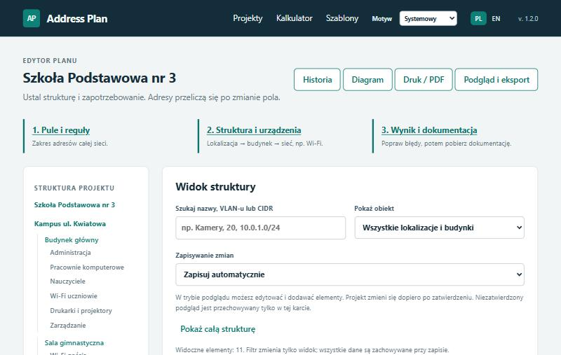
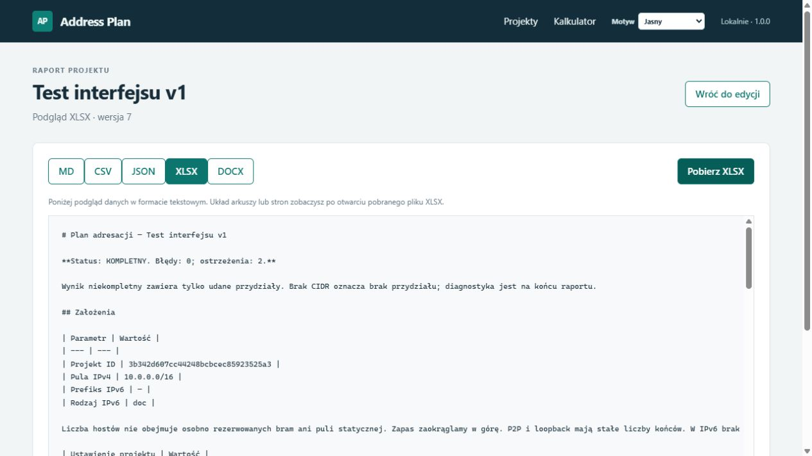

# Address Plan (AdresPlan)

> **EN:** A local web app for planning IPv4 (VLSM) and IPv6 addressing for multi-building networks. You describe sites, buildings, VLANs and device counts; the app allocates subnets, validates the plan and generates documentation (XLSX, DOCX, CSV, Markdown, JSON, print/PDF) plus starting gateway configurations for Cisco IOS and MikroTik. Polish and English interface, Python + FastAPI + HTMX + SQLite, 770 automated tests. Built with AI coding assistants — see [How it was built](#jak-powstał-projekt).

Lokalna aplikacja do planowania adresacji IPv4 (VLSM) i IPv6 w sieciach z kilkoma lokalizacjami, budynkami i VLAN-ami. Podajesz strukturę sieci i liczbę urządzeń, a program przydziela podsieci, sprawdza błędy i przygotowuje gotową dokumentację.



## Jaki problem rozwiązuje

Administrator małej lub średniej sieci (szkoła, biuro, parafia, firma z kilkoma budynkami) zwykle planuje adresację w Excelu i ręcznie liczy maski. To łatwo kończy się nakładającymi się podsieciami, brakiem miejsca na rozbudowę i nieaktualną dokumentacją.

Address Plan robi to automatycznie:

1. **Ustalasz pulę adresów**, np. `10.0.0.0/16`, i opcjonalnie prefiks IPv6.
2. **Opisujesz sieć**: lokalizacje → budynki → segmenty (VLAN-y) z liczbą urządzeń.
3. **Pobierasz dokumentację**: plan adresacji z bramami, zakresami DHCP i adresami statycznymi.

## Najważniejsze funkcje

- **Automatyczny podział IPv4 (VLSM)** z zapasem na rozwój, bramami i rezerwą adresów statycznych; jeden blok sumaryczny na budynek i lokalizację.
- **Plan IPv6**: /48 → /56 → /64, łącza /127, loopbacki /128, generator adresów ULA, numeracja podsieci według VLAN-u.
- **Walidacja na żywo**: kolizje, brak miejsca, błędne VLAN-y; podpowiedź, jakiej puli potrzeba.
- **Zamrażanie planu**: nowe segmenty trafiają w wolne miejsca bez przesuwania istniejących adresów.
- **Historia i porównywanie wersji**, szablony budynków, blokady zajętych podsieci, diagram hierarchii (SVG).
- **Kalkulator podsieci** IPv4/IPv6.
- **Eksport**: XLSX, DOCX, CSV, Markdown, JSON (import i eksport) oraz widok do druku/PDF.
- **Konfiguracja startowa Cisco IOS i MikroTik**: VLAN-y, bramy, DHCP i loopbacki wygenerowane z planu.
- **Interfejs po polsku i angielsku** (przełącznik PL / EN, także w CLI i raportach), jasny i ciemny motyw, praca w całości na własnym komputerze, bez chmury.

| Diagram hierarchii | Eksport do Excela |
| --- | --- |
|  |  |

## Technologie

- **Python 3.11+**: logika sieciowa oparta na standardowym module `ipaddress`.
- **FastAPI, Jinja2, HTMX**: lokalny interfejs w przeglądarce, bez zewnętrznych CDN.
- **SQLite**: zapis projektów, historia wersji, ochrona przed nadpisaniem zmian z drugiej karty.
- **Pydantic**: walidacja plików JSON projektu.
- **openpyxl, python-docx**: raporty Excel i Word.
- **pytest, Hypothesis, Ruff, mypy (strict)**, GitHub Actions i Docker.

## Uruchomienie

Wymagany jest Python 3.11 lub nowszy. Na Windows (PowerShell):

```powershell
python -m venv .venv
.\.venv\Scripts\python.exe -m pip install .
.\.venv\Scripts\adresplan.exe serve
```

Następnie otwórz **http://127.0.0.1:8000**. Gotowe przykłady do importu są w folderze [examples](examples/README.md), np. `examples/church-av.json`.

Na Linuksie i macOS zamiast `.\.venv\Scripts\` użyj `.venv/bin/`. Można też uruchomić aplikację w Dockerze: `docker compose up --build`.

Aplikacja ma także wiersz poleceń (`adresplan plan`, `calc`, `freeze`, `export`), opisany w [instrukcji CLI](docs/cli.md). Wersję angielską włączysz opcją `--lang en`.

## Przykład

Pula `192.168.10.0/24` i cztery segmenty o 100, 50, 25 i 10 urządzeniach:

| Segment | Hosty | Przydzielona podsieć | Użyteczne adresy |
| --- | ---: | --- | --- |
| A | 100 | 192.168.10.0/25 | 192.168.10.1–192.168.10.126 |
| B | 50 | 192.168.10.128/26 | 192.168.10.129–192.168.10.190 |
| C | 25 | 192.168.10.192/27 | 192.168.10.193–192.168.10.222 |
| D | 10 | 192.168.10.224/28 | 192.168.10.225–192.168.10.238 |

Wolny zostaje blok `192.168.10.240/28`. Przykładowe gotowe pliki: [raport Markdown](examples/exports/church-av.md) ([EN](examples/exports/church-av.en.md)), [Excel](examples/exports/church-av.xlsx), [Word](examples/exports/church-av.docx), [konfiguracja Cisco](examples/exports/church-av-cisco-ios.txt), [konfiguracja MikroTik](examples/exports/church-av-mikrotik.rsc).

## Jakość

- **770 testów automatycznych**: przykłady referencyjne, testy właściwościowe (Hypothesis) sprawdzające m.in. brak nakładania się podsieci, testy CLI, eksportów, bazy, interfejsu HTTP i kompletności tłumaczeń.
- Kontrola typów **mypy w trybie strict** i linter **Ruff** bez błędów.
- CI w GitHub Actions: Linux (Python 3.11 i 3.12), Windows, budowa paczki i test kontenera Docker.

Uruchomienie testów:

```powershell
.\.venv\Scripts\python.exe -m pip install -r requirements-dev.lock
.\.venv\Scripts\python.exe -m pip install --no-build-isolation --no-deps -e .
.\.venv\Scripts\python.exe -m pytest
```

## Jak powstał projekt

Projekt zbudowałem z pomocą asystentów AI do programowania (OpenAI GPT/Codex i Claude Code). Kod w większości wygenerowało AI. Moja rola:

- **specyfikacja wymagań**: co narzędzie ma robić, dla kogo i czego ma nie robić ([SPEC.md](docs/historia/SPEC.md));
- **wiedza dziedzinowa**: zasady planowania adresacji, VLSM, IPv6 i VLAN-ów;
- **prowadzenie pracy etapami** z odbiorem każdego etapu i decyzjami projektowymi ([PLAN.md](docs/historia/PLAN.md));
- **testowanie w praktyce**, zgłaszanie błędów i ocena wygody interfejsu.

Pełny zapis przebiegu prac jest w folderze [docs/historia](docs/historia/README.md).

## Struktura projektu

```text
src/adresplan/
  core/         obliczenia sieciowe (czysty Python, bez bazy i interfejsu)
  application/  import/eksport JSON, historia, szablony
  export/       CSV, Markdown, XLSX, DOCX, diagram SVG, konfiguracja Cisco/MikroTik
  store/        zapis w SQLite
  web/          interfejs FastAPI + HTMX (trasy w web/routes/)
  locale/       angielskie tłumaczenia (en.json)
  i18n.py       wybór języka i funkcja tr()
  cli.py        wiersz poleceń
tests/          testy automatyczne
examples/       przykładowe projekty i raporty
docs/           dokumentacja
```

Więcej: [architektura](docs/architecture.md) · [przewodnik użytkownika](docs/instrukcja.md) · [interfejs i API](docs/web.md) · [eksporty](docs/exports.md) · [format JSON](docs/json-format.md) · [historia zmian](CHANGELOG.md).

## Licencja

[MIT](LICENSE) © 2026 Tomasz Dyrc
