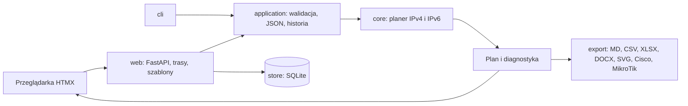

# Architektura

## Warstwy

| Pakiet | Odpowiada za |
| --- | --- |
| `core` | Obliczenia sieciowe na niezmiennych modelach: wielkość podsieci, alokator, hierarchia, IPv6, walidacja, zamrażanie. Tylko biblioteka standardowa; bez plików, bazy i HTTP |
| `application` | Walidacja wejścia (Pydantic), import i eksport JSON, historia zmian, szablony, komunikaty |
| `export` | Raporty i pliki: Markdown, CSV, Office, diagram SVG, konfiguracja urządzeń. Korzystają ze wspólnego raportu i nie liczą adresacji od nowa |
| `store` | SQLite: projekty, niezmienne wersje historii, szablony; zapis w transakcjach z kontrolą wersji |
| `web` | FastAPI, Jinja2 i HTMX. `app.py` składa aplikację, `state.py` trzyma wspólne narzędzia, a `routes/` dzieli trasy na projekty, bibliotekę, historię, eksporty, kalkulator, API i język |
| `i18n.py` | Tłumaczenia: polski tekst w kodzie jest kluczem, angielski słownik leży w `locale/en.json` |
| `cli.py` | Wiersz poleceń z tymi samymi obliczeniami co interfejs |

Test pilnuje, żeby `core` importował wyłącznie bibliotekę standardową i samego siebie.

## Jak działa przydział

1. Ze wszystkich segmentów wyliczana jest potrzebna wielkość podsieci (hosty, zapas, bramy, adresy statyczne).
2. Z puli odejmowane są blokady zajętych podsieci, a potem sieci przypięte ręcznie.
3. Pozostałe potrzeby dostają miejsce metodą best-fit, od największej. Ten sam alokator obsługuje IPv4 i IPv6.
4. Hierarchia działa od góry: lokalizacja dostaje blok, budynki dzielą go między siebie, segmenty dzielą blok budynku.

Wszystkie obliczenia używają modułu `ipaddress`. Program nigdy nie tworzy listy wszystkich hostów, więc działa także dla dużych pul IPv6.

## Języki

Funkcja `tr()` zwraca tekst w aktywnym języku. Język jest zmienną kontekstową (`ContextVar`): interfejs ustawia go dla każdego żądania (ciasteczko lub nagłówek `Accept-Language`), a CLI na czas jednego polecenia. Dzięki temu eksporty nie potrzebują dodatkowego parametru. Testy sprawdzają, że każdy tekst ma tłumaczenie i że w wersji angielskiej nie zostaje polski tekst aplikacji.

## Zasady przy rozwijaniu

- Logika sieciowa należy do `core`, nie do JavaScriptu, SQL ani eksporterów.
- Plan częściowy jest pokazywany i eksportowany, ale nie może zostać zamrożony.
- Zamrażanie nie powiększa samo rodzica działającej sieci; brak miejsca to błąd.
- Prefiks ULA jest losowany poza rdzeniem i zapisywany jako dane wejściowe.
- Nowy tekst widoczny dla użytkownika piszemy po polsku w `tr()` i dodajemy tłumaczenie do `locale/en.json`.
