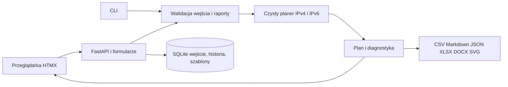

# Architektura Address Plan

## Przepływ danych

`core` to reguły sieciowe i obliczenia na niezmiennych modelach. Nie odczytuje plików, zegara, bazy ani HTTP. Biblioteka `ipaddress` zapewnia arytmetykę CIDR; kod nie tworzy list wszystkich hostów. Ten sam generyczny alokator obsługuje obie rodziny. Najpierw odejmuje blokady zajętych podsieci, potem rozpatruje przypięcia i przydziela największe potrzeby metodą best-fit.

`application` waliduje wejście Pydantic, importuje JSON i przygotowuje świeży plan. Migawka planu w pliku jest poglądowa. Eksporty używają wspólnego raportu; nie implementują ponownie VLSM. Eksport JSON ma wersję 2; importer obsługuje wersje 1 i 2.

`store` przechowuje w SQLite bieżące wejście i metadane, niezmienne migawki historii (wejście oraz wynik) i szablony budynków. Osobny klucz zapisu pozwala importować dwa projekty o tym samym wewnętrznym ID. Zapis odbywa się w transakcji `BEGIN IMMEDIATE`; oczekiwana wersja musi zgadzać się z wersją bazy. Stara karta otrzymuje 409, zamiast nadpisywać cudzą zmianę. Schemat SQLite ma wersję 2. Migracja z wersji 1 działa w jednej transakcji i zapisuje stan początkowy historii; nowsze i obce schematy są odrzucane.

`web` łączy FastAPI, Jinja2 i lokalny HTMX. Zwykła edycja po 300 ms wymienia wynik i drzewo, zachowując pola. Zmiany struktury wymieniają formularz i na czas żądania go blokują. Kolejka zapisów i nagłówek rewizji chronią kolejność odpowiedzi. Motyw jest lokalną preferencją przeglądarki.

`export` tworzy raporty tekstowe oraz Office. XLSX zapisuje wartości jako tekst, bez aktywnych formuł, hiperłączy i zaokrąglania dużych liczb IPv6. CSV dodatkowo neutralizuje tekst przypominający formułę. DOCX tworzy zwykłe teksty i tabele, bez makr. Zapis pliku najpierw tworzy plik tymczasowy, a następnie atomowo podmienia docelowy.

## Reguły ważne przy utrzymaniu

- Wynik częściowy jest użyteczny diagnostycznie, ale nie może być zamrożony. Eksport musi zachować jego status i błędy.
- Zamrażanie przypina IPv4, IPv6 i infrastrukturę. Nie powiększa samoczynnie rodzica działającej sieci.
- Kopia segmentu ma nowe ID i puste przypięcia obu rodzin. VLAN zostaje skopiowany; w tej samej lokalizacji może pojawić się ostrzeżenie o jego powtórzeniu.
- Nie dodawaj logiki sieciowej do JavaScript, SQL ani generatorów dokumentów. Rozszerzaj rdzeń i testy referencyjne T1–T5.
- ULA losujemy poza rdzeniem i zapisujemy jako wejście; przeliczenie nie zmienia prefiksu.
- Domyślny serwer jest lokalny. Jawne `--host 0.0.0.0` służy kontenerowi, a Compose mapuje port wyłącznie na `127.0.0.1`. Aplikacja nie zawiera uwierzytelniania do publicznego hostingu.

## Co warto umieć wyjaśnić podczas prezentacji projektu

1. Dlaczego 100 hostów, 25% zapasu, jedna brama i osiem statycznych wymagają 134 adresów użytecznych, czyli /24.
2. Jak hierarchia upraszcza trasy: segmenty mieszczą się w jednym bloku budynku, a budynki w lokalizacji.
3. Dlaczego LAN IPv6 używa /64, P2P /127, a loopback /128.
4. Co chroni freeze i dlaczego duplikat segmentu musi mieć inne ID oraz puste przypięcie.
5. Jak testy deterministyczności, rozłączności i zawierania uzupełniają ręczną weryfikację adresów.

Wymagana wiedza do rozwijania programu: Python, dataclasses, Pydantic, pytest/Hypothesis; dla interfejsu podstawy HTTP, HTML i HTMX; dla wdrożenia SQLite, Git oraz opcjonalnie Docker. Do korzystania z aplikacji wystarczą Python, przeglądarka i wiedza sieciowa.
