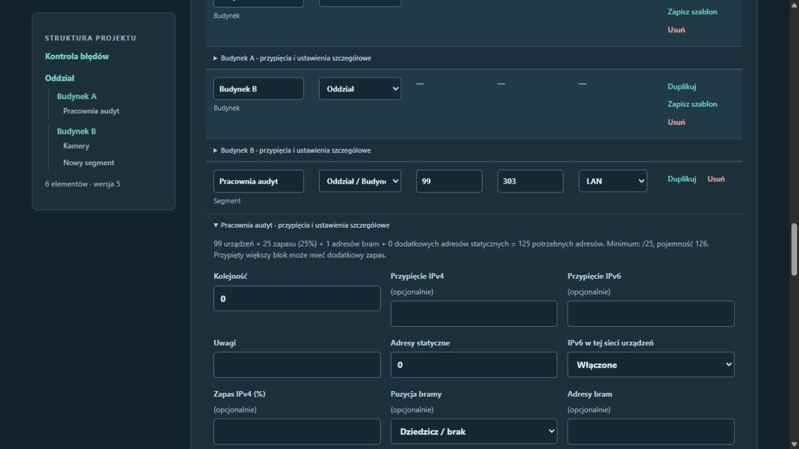

# Kontrola aplikacji — 16.10.2026

Zakres: zapis formularzy, duże struktury, podgląd zmian, filtrowanie, wyjaśnienia adresacji i biblioteka szablonów. Próby wykonywano na osobnych bazach; projektów użytkownika nie edytowano.

## Wykryte i poprawione błędy

| Priorytet | Problem i przykład | Poprawka |
| --- | --- | --- |
| Wysoki | Po utworzeniu podglądu kolejna edycja pozostawiała przycisk zatwierdzania aktywny. Kliknięcie przed upływem opóźnienia 300 ms mogło zapisać poprzednią propozycję. | Zatwierdzenie jest dostępne dopiero dla odpowiedzi odpowiadającej ostatniej edycji, bez żądania w toku. Zmiana danych i operacje strukturalne blokują przycisk od razu. Błąd obliczeń nie odblokowuje zatwierdzenia. |
| Wysoki | Domyślny limit 1000 pól formularza odrzucał zapis większej sieci. Każdy segment ma wiele pól, także w zwiniętych szczegółach. | Skończony limit 100 000 pól przy zachowaniu ograniczenia rozmiaru całego żądania. Test zapisuje formularz ze 100 segmentami i sprawdza ostatni segment oraz zachowanie pozostałych obiektów. Nie oznacza to deklaracji wydajności dla dowolnie dużej sieci. |
| Średni | Po zwykłym automatycznym zapisie wyszukiwarka zachowywała poprzednią nazwę, VLAN, CIDR i przynależność obiektu. Wyjaśnienie doboru podsieci również pokazywało stare zapotrzebowanie. | Odpowiedź odświeża dane filtrów, podpisy szczegółów i wyliczenia bez zastępowania edytowanych pól oraz utraty kursora. |
| Średni | Gdy zmiana IPv6 czekała na zapis, skrypt zastępował wybraną akcję poleceniem przełączenia IPv6. Mogło to pominąć np. dodanie elementu lub zamrożenie adresów. | Jawnie wybrana akcja ma pierwszeństwo; zmiana użycia IPv6 nadal jest uwzględniana w tym samym formularzu. |
| Średni | Utworzenie wzorca pozwalało na nazwę ponad 200 znaków, natomiast późniejsze operacje odmawiały nawet przeniesienia takiego wzorca do kosza. | Wspólna walidacja nowych nazw (1–200 znaków), wykonana przed zapisem edycji projektu. Starsze wzorce z długimi nazwami nadal można aktualizować, przenosić do kosza i przywracać. Nieprawidłowa nowa nazwa zgłasza błąd danych (HTTP 422). |

## Rzeczy do dopracowania przed wydaniem

- **Spójność wersji i paczek:** kod nadal zgłasza 1.1.0, a wcześniejsze pliki w `dist` nie zawierają obecnych usprawnień. Przed publikacją trzeba nadać aktualizacji osobny numer, zbudować paczki i sprawdzić instalację z nowego wydania. Audyt nie przebudowuje dawnych artefaktów.
- **Zachowanie propozycji przy konflikcie kart:** kontrola rewizji chroni zapisany projekt przed nadpisaniem. Przy odrzuconym zatwierdzeniu podglądu przyda się możliwość odzyskania propozycji lub pobrania jej JSON-u. Obecny podgląd pozostaje roboczym stanem bieżącej strony; nie ma trwałego zapisu wersji roboczej.
- **Długie sesje przeglądarkowe:** dołożone testy stanu skryptu sprawdzają kolejność edycji i odpowiedzi, lecz nie zastępują pełnych testów przeglądarkowych. Warto później zautomatyzować także dwa otwarte edytory i przerwanie połączenia podczas zapisu.

## Weryfikacja

- Końcowy zestaw: **750 testów przeszło na Pythonie 3.12.14 oraz 750 na 3.11.0**. Cztery dodatkowe testy JavaScript przeszły; Ruff (kontrola i formatowanie), mypy oraz kontrola składni JavaScript bez błędów.
- Testy HTTP obejmują duży formularz, odświeżenie danych po zapisie, brak częściowego zapisu przy błędnej nazwie wzorca oraz obsługę dawnych wzorców.
- Cztery dodatkowe testy stanu JavaScript sprawdzają aktualność podglądu, opóźnioną odpowiedź, błąd żądania i zachowanie jawnej akcji podczas przełączenia IPv6. Uruchomienie: `node --test tests/web_state.test.cjs`. Node.js jest potrzebny tylko do tych dodatkowych testów, nie do działania aplikacji.
- W przeglądarce sprawdzono nową nazwę w wyszukiwaniu, aktualny VLAN i CIDR, zmianę wyjaśnienia z 20 na 81 i 99 urządzeń, natychmiastową blokadę starego podglądu, zapis ostatniej propozycji oraz dodanie segmentu podczas włączenia IPv6. Konsola bez błędów i ostrzeżeń.
- Po restarcie serwer na `http://127.0.0.1:8000` udostępnia poprawki. Strona główna, biblioteka i skrypt odpowiedziały HTTP 200. Trzy projekty użytkownika zachowały nazwy, rewizje i daty zapisu (porównano ten sam moment UTC, niezależnie od formatowania strefy czasowej).

