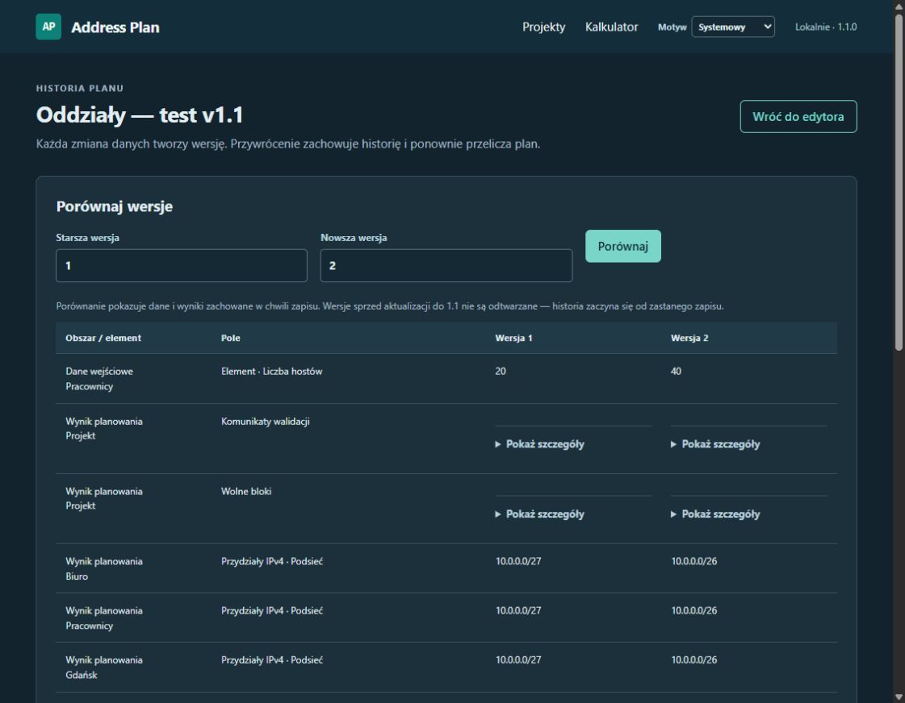
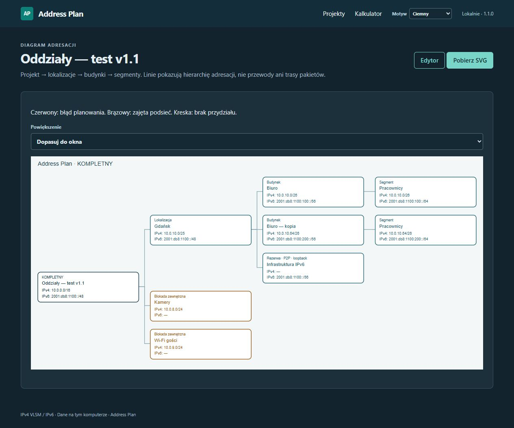

# Address Plan 1.1

Lokalne wydanie 1.1.0 z 16.10.2026 rozszerza działającą wersję 1.0. Nie wymaga nowych bibliotek ani dodatkowych usług. Wymagania: Python 3.11+, przeglądarka i podstawy CIDR/VLAN/IPv6.

## Historia i porównywanie

W edytorze wybierz **Historia**. Możesz porównać dwie zachowane wersje: dane wejściowe, przydziały IPv4/IPv6, zakresy, wolne bloki i diagnostykę. Na przykład zmiana hostów z 20 na 40 może zmienić podsieć z /27 na /26. Porównanie używa zapamiętanych wyników, a nie ponownego przeliczenia starego planu aktualnym silnikiem.

**Przywróć wersję** tworzy nową rewizję i ponownie wylicza przywrócone wejście. Nie usuwa wersji późniejszych. Stara karta nie nadpisze nowszego zapisu. Identyczny autosave nie tworzy nowej rewizji; historia jest stronicowana po 50 pozycji.



## Kopie budynków i szablony

Przycisk **Duplikuj** przy budynku kopiuje jego segmenty do tej samej lokalizacji. Możesz następnie wybrać inną lokalizację w polu rodzica. Kopia ma nowe identyfikatory i puste przypięcia IPv4/IPv6. Nie przenosi blokad, ponieważ opisują konkretne, zajęte adresy oryginału.

Przycisk **Zapisz szablon** zachowuje budynek w bibliotece SQLite. W sekcji **Szablony budynków** wybierz szablon, lokalizację i nazwę nowego budynku. Szablon można wykorzystać w innym projekcie. LAN/mgmt zachowują efektywne ustawienia zapasu i bram ze źródła. P2P/loopback zachowują specjalne reguły. Globalne reguły IPv6 i prefiks P2P pochodzą z projektu docelowego.

VLAN-y są kopiowane. Powtórzenie w lokalizacji nadal wyświetla ostrzeżenie. Kopia może nie zmieścić się w zamrożonym budynku/lokalizacji — wtedy pojawi się błąd, bez przesuwania istniejących podsieci.

## Zajęte podsieci

W sekcji **Zajęte podsieci — blokady** wybierz pulę: projekt, lokalizację albo budynek. Wklej listę, np.:

```text
# Istniejące sieci, których nie wolno przydzielić
10.0.8.0/24; Kamery
10.0.9.0/24; Wi-Fi gości
```

Obsługiwane są IPv4 i IPv6, ścisły zapis CIDR i opis po średniku. Cała lista przechodzi walidację formatu przed zapisem. Bity hosta, np. `10.0.8.1/24`, są błędem. Niepoprawna pula lub konflikt z przypięciem oznacza plan niekompletny.

Zakres ma znaczenie: blokada projektu wyklucza sieć z przydziałów lokalizacji; blokada budynku wyklucza sieć z przydziałów jego segmentów. Aby zachować zewnętrzną sieć wewnątrz bloku swojego budynku, wybierz ten budynek. Zajęty zakres nie będzie pokazany jako wolny. Nakładające się blokady jednej puli liczą się tylko raz. Metryki zajętości obejmują przydziały i blokady.

Dodanie blokady może zmienić automatyczne przydziały przez zmianę wolnych bloków i wybór best-fit. Przed rozbudową wdrożonej sieci użyj **Zamroź adresy**. Kolizja blokady z zamrożoną podsiecią powoduje błąd zamiast jej przesunięcia.

Blokady trafiają do JSON, Markdown, DOCX, widoku druku i dodatkowego arkusza **Blokady** w XLSX. CSV nadal przedstawia segmenty. W v1.1 blokady nie mają osobnego zakresu wewnątrz pul infrastruktury IPv6 P2P/loopback; można blokować zakres na poziomie lokalizacji, a automatyczny blok infrastruktury go ominie.

## Diagram

Przycisk **Diagram** pokazuje hierarchię projektu i przydziały obu rodzin. Czerwony oznacza błąd, brązowy blokadę. Możesz dopasować obraz do okna albo wybrać pełny rozmiar. **Pobierz SVG** zapisuje samodzielny plik, odpowiedni do README i dokumentacji; nie potrzebuje bibliotek z Internetu.

Diagram przedstawia hierarchię adresacji. Linie nie opisują fizycznych połączeń, routingu ani urządzeń.



## Aktualizacja i dane

Uruchomienie nie zmienia się: `adresplan serve`. Zatrzymaj działającą starszą instancję i uruchom ponownie. W tym projekcie `.venv` korzysta z kodu źródłowego, więc zobaczy zmiany po restarcie. Przy zwykłej instalacji pakietu zaktualizuj go przez `python -m pip install .` albo z nowego wheel.

Przy pierwszym uruchomieniu baza SQLite migruje transakcyjnie z wersji 1 do 2. Zastany projekt zachowuje numer rewizji i rozpoczyna historię. Wersje sprzed aktualizacji nie były przechowywane i nie da się ich odzyskać. Baza zawiera bieżące wejście, historię migawek i bibliotekę szablonów. Historię zachowujemy bez automatycznego usuwania.

Eksporty JSON mają teraz `schema_version=2`; import przyjmuje również starszą wersję 1. JSON projektu nie obejmuje całej historii ani biblioteki szablonów. Aby przenieść wszystkie dane, zamknij aplikację i skopiuj plik SQLite. Przed aktualizacją można w ten sam sposób wykonać kopię bazy; aplikacja 1.0 nie otworzy bazy po migracji do 2.

700 testów zaliczono na Pythonie 3.11 i 3.12. Szczegóły odbioru: [v1.1-verification.md](v1.1-verification.md). Publikacja na GitHubie i wybór licencji nadal pozostają oddzielnymi krokami.
